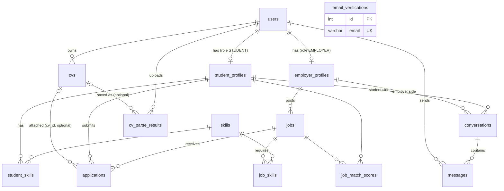

# Database Design — StudentJob Marketplace

_Status: proposed on branch `KhangTran/pm-ai-analysis` (2026-11-23). Owner-approved direction: keep MySQL 8, versioned SQL migrations, AI tables created now, embeddings deferred. Implementation: `database/migrations/*.sql`, `database/seeds/*.sql`, `database/docker-compose.yml`, `database/README.md`._

---

## 1. Current state & gaps

### 1.1 What the backend actually queries (main @ `adc0c86`)

Sources read: `backend/src/models/*.js`, `backend/src/controllers/*.js` (inline SQL in admin, adminUser, application, chat controllers), `backend/src/sockets/chatSocket.js`.

| Table | Columns used by code | Used in |
|---|---|---|
| `users` | id, email, password, role, **status** | userModel, profileModel, adminUserModel, adminUserController (`UPDATE users SET status = ?` with `ACTIVE`/`BLOCKED`), admin/application joins |
| `student_profiles` | id, user_id, full_name, phone, university, major, bio | userModel, profileModel, applicationModel, chatModel/Controller/Socket, admin models |
| `employer_profiles` | id, user_id, company_name, phone, address, description | userModel, profileModel, jobModel, chat*, admin* |
| `jobs` | id, employer_id, title, description, location, salary_min, salary_max, job_type, deadline, status, moderation_status, rejection_reason, created_at | jobModel, adminController, applicationController |
| `applications` | id, job_id, student_id, cv_url, cover_letter, status, applied_at | applicationModel, applicationController, adminApplicationModel |
| `email_verifications` | email (upsert key), otp_hash, expires_at, registration_payload (JSON), attempts, verified_at | verificationModel |
| `cvs` | id, user_id, title, template, personal_info, education, experience, skills, projects, certifications (JSON), updated_at (ORDER BY) | cvModel |
| `conversations` | id, student_id, employer_id, created_at; **unique (student_id, employer_id) required** by `INSERT … ON DUPLICATE KEY UPDATE id = LAST_INSERT_ID(id)` | chatModel, chatController, chatSocket |
| `messages` | id, conversation_id, sender_id, content, created_at | chatModel, chatSocket |

### 1.2 What the ID columns refer to
- `conversations.student_id` → **`student_profiles.id`** (chatModel joins `c.student_id = sp.id`; controller inserts `students[0].id` from `SELECT id FROM student_profiles WHERE user_id = ?`).
- `conversations.employer_id` → **`employer_profiles.id`** (joins `c.employer_id = ep.id`; request body `employerId` is checked against `employer_profiles.id`).
- `messages.sender_id` → **`users.id`** (chatController and chatSocket insert `req.user.id` / `socket.user.id` from the JWT, which is `users.id`).
- `applications.student_id` → `student_profiles.id`; `jobs.employer_id` → `employer_profiles.id`; `cvs.user_id` → `users.id`.

### 1.3 Existing SQL files vs code

| File | Problem |
|---|---|
| `database/schema.sql`, `backend/database/schema_with_email.sql` | mysqldump-style; only the 5 core tables (+ email migration appended in the backend copy). |
| `database/schema_with_email.sql` | Creates `applications` **before** `jobs`/`student_profiles` with FK checks on → fails on an empty DB; also runs `UPDATE jobs … WHERE id IN (1,2)` before any seed. |
| `database/email_moderation_migration.sql` | `ALTER TABLE jobs ADD COLUMN moderation_status …` is not idempotent; fails if the schema already has it. |
| all | **Missing tables**: `cvs`, `conversations`, `messages` → CV builder and chat fail on a fresh install. |
| all | **Missing column** `users.status` → admin block/unblock (`PATCH /api/admin/users/:id/status`) fails with "Unknown column". |
| all | Two drifting copies (`database/` vs `backend/database/`); no versioning; no `updated_at`; no indexes beyond FKs. |
| `seed.sql` | No ADMIN account; demo jobs not APPROVED (invisible in `GET /api/jobs`) unless the migration UPDATE is run afterwards. |

---

## 2. Target schema

### 2.1 Principles
- MySQL 8.x, InnoDB, `utf8mb4` / `utf8mb4_unicode_ci` on every table.
- **Every table/column name the code uses is kept**, with compatible types (`INT` PKs, same ENUM values), so the backend runs unchanged.
- Additive changes only: new tables, `updated_at`, `users.status`, `applications.cv_id`, indexes.
- One file per concern under `database/migrations/NNN_name.sql`, applied in order; seeds separate in `database/seeds/`.
- No `CREATE DATABASE`/`USE` inside migrations: the runner (Docker entrypoint or `mysql <db> < file`) selects the database.

### 2.2 ER diagram

### 2.3 Tables

Legend: PK primary key, UK unique, FK foreign key, IX index. `ts` = `TIMESTAMP`.

#### Core — `001_users_profiles.sql`

**users**
| Column | Type | Notes |
|---|---|---|
| id | INT AI | PK |
| email | VARCHAR(255) NOT NULL | UK `email` — login lookup |
| password | VARCHAR(255) NOT NULL | bcrypt hash |
| role | ENUM('STUDENT','EMPLOYER','ADMIN') NOT NULL | |
| status | ENUM('ACTIVE','BLOCKED') NOT NULL DEFAULT 'ACTIVE' | **new**; used by admin block/unblock |
| created_at | ts NULL DEFAULT CURRENT_TIMESTAMP | |
| updated_at | ts NOT NULL DEFAULT CURRENT_TIMESTAMP ON UPDATE | **new** |
IX `idx_users_role` (role) — admin e-mail lookup `WHERE role='ADMIN'`, admin lists.

**student_profiles** — id PK, user_id INT NOT NULL UK → FK users(id) CASCADE, full_name VARCHAR(100) NOT NULL, phone VARCHAR(20), university VARCHAR(255), major VARCHAR(100), bio TEXT, created_at, updated_at (**new**). Why: 1:1 with users; profile id is what applications/conversations reference.

**employer_profiles** — id PK, user_id UK → FK users(id) CASCADE, company_name VARCHAR(255) NOT NULL, phone VARCHAR(20), address VARCHAR(255), description TEXT, created_at, updated_at (**new**).

#### Jobs & applications — `002_jobs_applications.sql`

**jobs**
| Column | Type | Notes |
|---|---|---|
| id | INT AI | PK |
| employer_id | INT NOT NULL | FK employer_profiles(id) CASCADE |
| title | VARCHAR(255) NOT NULL | |
| description | TEXT NOT NULL | |
| location | VARCHAR(255) NULL | |
| salary_min, salary_max | DECIMAL(12,2) NULL | CHECK min ≤ max when both set |
| job_type | ENUM('PART_TIME','FULL_TIME','FREELANCE') NOT NULL | |
| deadline | DATE NULL | |
| status | ENUM('OPEN','CLOSED') DEFAULT 'OPEN' | |
| moderation_status | ENUM('PENDING','APPROVED','REJECTED') NOT NULL DEFAULT 'PENDING' | admin moderation |
| rejection_reason | VARCHAR(1000) NULL | |
| created_at | ts NULL DEFAULT CURRENT_TIMESTAMP | |
| updated_at | ts NOT NULL … ON UPDATE | **new** |
Indexes: `idx_jobs_public (moderation_status, status, created_at)` — public list (`WHERE moderation_status='APPROVED' [AND status='OPEN'] ORDER BY created_at DESC`) and admin pending list; `idx_jobs_employer_created (employer_id, created_at)` — employer's own jobs (replaces the plain FK index).

**applications**
| Column | Type | Notes |
|---|---|---|
| id | INT AI | PK |
| job_id | INT NOT NULL | FK jobs(id) CASCADE |
| student_id | INT NOT NULL | FK student_profiles(id) CASCADE |
| cv_url | VARCHAR(500) NULL | uploaded PDF path/URL (kept) |
| cover_letter | TEXT NULL | |
| status | ENUM('PENDING','ACCEPTED','REJECTED') DEFAULT 'PENDING' | |
| applied_at | ts NULL DEFAULT CURRENT_TIMESTAMP | |
| updated_at | ts NOT NULL … ON UPDATE | **new** |
| cv_id | INT NULL | **new**, added in 004; FK cvs(id) ON DELETE SET NULL — lets a student apply with a builder CV; not used by code yet |
Indexes: UK `uq_application_job_student (job_id, student_id)` — one application per job, also serves "applications by job"; `idx_applications_student_applied (student_id, applied_at)` — "my applications" ordered by date.

#### Email verification — `003_email_verifications.sql`
**email_verifications** — unchanged: id PK, email VARCHAR(255) UK (upsert key), otp_hash CHAR(64), expires_at DATETIME (IX for cleanup), registration_payload JSON, attempts TINYINT UNSIGNED DEFAULT 0, verified_at DATETIME NULL, created_at. No FK: rows exist before the user does.

#### CVs — `004_cvs.sql`
**cvs**
| Column | Type | Notes |
|---|---|---|
| id | INT AI | PK |
| user_id | INT NOT NULL | FK users(id) CASCADE — code uses `req.user.id` (users.id) |
| title | VARCHAR(255) NOT NULL | controller limits to 255 |
| template | VARCHAR(50) NOT NULL DEFAULT 'modern' | controller limits to 50 |
| personal_info, education, experience, skills, projects, certifications | JSON NULL | model writes `JSON.stringify(x ?? null)` |
| created_at | ts NOT NULL DEFAULT CURRENT_TIMESTAMP | |
| updated_at | ts NOT NULL … ON UPDATE | list ordered by it |
IX `idx_cvs_user_updated (user_id, updated_at)` — `WHERE user_id=? ORDER BY updated_at DESC`.
Then: `ALTER TABLE applications ADD cv_id INT NULL` + FK `fk_application_cv` → cvs(id) ON DELETE SET NULL + IX.

#### Chat — `005_chat.sql`
**conversations** — id PK; student_id INT NOT NULL FK student_profiles(id) CASCADE; employer_id INT NOT NULL FK employer_profiles(id) CASCADE; created_at; updated_at. **UK `uq_conversation_pair (student_id, employer_id)`** (required by the upsert); IX `(employer_id, created_at)` for the employer inbox (student inbox uses the UK prefix).
**messages** — id `INT` AI PK (consistent with the rest; move to BIGINT if volume ever demands); conversation_id INT NOT NULL FK conversations(id) CASCADE; sender_id INT NOT NULL FK users(id) CASCADE; content TEXT NOT NULL (code caps at 5000 chars); created_at TIMESTAMP NOT NULL DEFAULT CURRENT_TIMESTAMP. IX `idx_messages_conversation_created (conversation_id, created_at, id)` — matches `WHERE conversation_id=? ORDER BY created_at, id`; IX on sender_id via FK.

#### AI — `006_ai.sql` (created now, unused by code yet)

**skills** — id PK; name VARCHAR(100) NOT NULL (display); normalized_name VARCHAR(100) NOT NULL **UK** (lower-case, trimmed, e.g. `node.js` → `nodejs`; dedupes "ReactJS"/"React"); category VARCHAR(50) NULL (e.g. `programming`, `language`, `soft`); created_at. Why: CV `skills` JSON and job descriptions are free text; matching needs a shared vocabulary.

**student_skills** — PK (student_id, skill_id); student_id FK student_profiles CASCADE; skill_id FK skills CASCADE; source ENUM('manual','cv_parse','ai') NOT NULL DEFAULT 'manual' (provenance, so AI-inferred skills can be shown/removed separately); level TINYINT UNSIGNED NULL CHECK 1–5; created_at, updated_at. IX (skill_id) for "students with skill X".

**job_skills** — PK (job_id, skill_id); FKs CASCADE; is_required BOOLEAN NOT NULL DEFAULT TRUE; weight DECIMAL(4,2) NOT NULL DEFAULT 1.00 CHECK > 0; created_at. IX (skill_id).

**cv_parse_results** — id PK; user_id FK users CASCADE; cv_id INT NULL FK cvs SET NULL (set when the user saves the draft); parser ENUM('regex','llm') NOT NULL; model VARCHAR(100) NULL (LLM model id, NULL for regex); parser_version VARCHAR(20) NULL; source_file_type ENUM('pdf','docx') NULL; extracted JSON NOT NULL (the CVPayload returned); warnings JSON NULL; created_at. IX (user_id, created_at). **No full CV text and no file stored** (PII minimisation); retention to be defined (e.g. purge after 90 days). Why: audit/quality comparison of regex vs LLM, cost tracking per model.

**job_match_scores** — PK (student_id, job_id); FKs CASCADE; score DECIMAL(5,2) NOT NULL CHECK 0–100; method ENUM('skill_overlap','embedding','llm') NOT NULL; explanation JSON NULL (e.g. matched/missing skills, so the UI can say *why*); computed_at TIMESTAMP NOT NULL DEFAULT CURRENT_TIMESTAMP ON UPDATE. IX (student_id, score) for "top jobs for me"; IX (job_id, score) for "top candidates". A precomputed cache: recompute when profile/job skills change.

**Embeddings — deferred.** Options when needed:
1. JSON/`BLOB` column of float32 in a side table (`job_embeddings`, `student_embeddings` with `model`, `dim`, `vector`, `updated_at`) and cosine similarity in Node — fine for < ~10k jobs.
2. MySQL 9.x `VECTOR` type (HeatWave/9.0+) — not in 8.x; would require an upgrade.
3. External vector store (pgvector, Qdrant) — extra infra.
Recommendation: start with rule-based `skill_overlap`; add option 1 only if evaluation shows skill overlap is insufficient. Store model id + dimension with each vector so models can be swapped.

### 2.4 Seed (`database/seeds/001_demo.sql`)
Demo password for every account: `Student@123` (same bcrypt hash as the old seed).
- users: 1 `student.demo@example.com` (STUDENT), 2 `employer.demo@example.com` (EMPLOYER), 3 `admin.demo@example.com` (ADMIN — role supported by the code; admin routes use `authorizeRole("ADMIN")`).
- profiles for 1 and 2; 2 jobs OPEN + **APPROVED**; 1 application (student → job 1); 1 demo CV; 6 skills; student_skills and job_skills rows.
- Explicit ids are inserted, so AUTO_INCREMENT continues after them.
